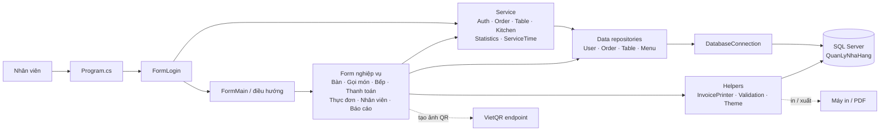
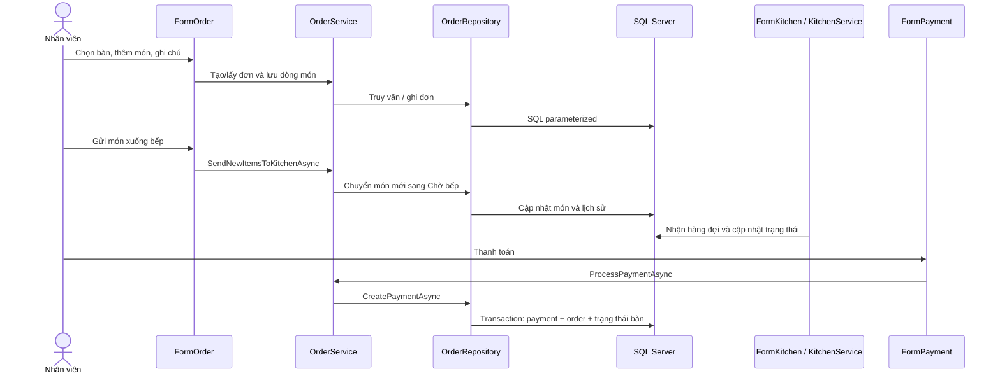

# Tài liệu kiến trúc — Quản Lý Nhà Hàng

> Tài liệu được lập từ việc đọc mã nguồn và cấu hình hiện có vào ngày 19/10/2026. Không chạy ứng dụng, không chạy bộ kiểm thử và không thay đổi mã trong quá trình rà soát.

## 1. Tóm tắt

Đây là ứng dụng desktop Windows Forms cho hoạt động nhà hàng: quản lý bàn, thực đơn, đơn gọi món, hàng đợi bếp, thanh toán, in hóa đơn, nhân viên và báo cáo. Ứng dụng kết nối trực tiếp tới SQL Server bằng `Microsoft.Data.SqlClient`; không thấy có backend HTTP/API riêng.

Kiến trúc có thể xem là mô hình phân lớp trong một ứng dụng desktop:

1. **Giao diện:** các form Windows Forms nhận thao tác và trình bày dữ liệu.
2. **Nghiệp vụ:** các service xử lý quy tắc đơn hàng, xác thực, bếp, bàn và thống kê.
3. **Truy cập dữ liệu:** repository thực hiện truy vấn SQL.
4. **Lưu trữ:** SQL Server giữ tài khoản, danh mục, món, bàn, đơn, thanh toán và lịch sử trạng thái.

Các lớp được tách theo thư mục nhưng chưa tách thành nhiều project/assembly; form vẫn trực tiếp gọi service/repository ở một số chỗ và một số helper truy cập database trực tiếp.

## 2. Tech stack

| Thành phần | Công nghệ hiện tại | Ghi chú |
|---|---|---|
| Ứng dụng | C# / .NET 10 (`net10.0-windows`) | Windows desktop, không phải ứng dụng web |
| UI | Windows Forms | Có hỗ trợ DPI và giao diện tự dựng bằng control |
| Database | Microsoft SQL Server | Cấu hình hiện trỏ tới `.\SQLEXPRESS`, database `QuanLyNhaHang`, Windows Authentication |
| Driver SQL | `Microsoft.Data.SqlClient` 5.2.2 | Có thể truy vấn dữ liệu và cập nhật database qua ADO.NET |
| Biểu đồ | `PanoramicData.System.Windows.Forms.DataVisualization` 1.0.7 | Dùng trong báo cáo thống kê |
| QR chuyển khoản | VietQR image endpoint | Tạo ảnh QR online; ứng dụng cần Internet để tải QR |
| In/đầu ra hóa đơn | Windows printing và PDF | Có preview, in, lưu PDF, lưu tùy chọn in và ghi log nếu bảng log tồn tại |
| Kiểm thử | Chưa thấy project hoặc bộ test trong solution | Cần kiểm thử thủ công các luồng nghiệp vụ trước khi dùng thật |

NuGet Gallery hiện ghi nhận `Microsoft.Data.SqlClient` 7.0.3 là bản ổn định mới hơn 5.2.2; cần đánh giá tương thích và chạy hồi quy trước khi nâng cấp. [NuGet: Microsoft.Data.SqlClient](https://www.nuget.org/packages/Microsoft.Data.SqlClient)

NuGet Gallery liệt kê phiên bản 1.0.7 cho thư viện biểu đồ, cũng là phiên bản dự án đang dùng. Tài liệu này không kết luận package đó có lỗ hổng; nên kiểm tra advisory và tình trạng duy trì trước khi phát hành. [NuGet: PanoramicData WinForms DataVisualization](https://www.nuget.org/packages/PanoramicData.System.Windows.Forms.DataVisualization)

## 3. Cấu trúc thư mục

```text
.
├── QuanLyNhaHang.slnx            Solution Visual Studio
├── ARCHITECTURE.md               Tài liệu kiến trúc này
└── QuanLyNhaHang/
    ├── Program.cs                Điểm vào ứng dụng, mở FormLogin
    ├── App.config                VietQR và thông tin in hóa đơn
    ├── QuanLyNhaHang.csproj      Target framework, packages, resources
    ├── Controls/                  Control WinForms dùng lại
    ├── Data/                      Kết nối SQL và repository
    ├── Database/                  Schema, seed data, migration và cleanup SQL
    ├── Forms/                     Màn hình nghiệp vụ và form phụ
    ├── Helpers/                   Theme, validation, thông báo, in hóa đơn
    ├── Images/                    Hình ảnh giao diện
    ├── Models/                    Entity/DTO nghiệp vụ
    ├── Properties/                 Cài đặt ứng dụng, ví dụ tên đăng nhập đã nhớ
    └── Service/                    Nghiệp vụ ứng dụng và phân quyền
```

### Các model chính

- `User`, `Role`: tài khoản nhân viên và vai trò.
- `Table`: bàn, sức chứa và trạng thái.
- `MenuItem`, `Category`: món ăn và nhóm món.
- `Order`, `OrderDetail`, `OrderStatus`, `Payment`: đơn, dòng món, trạng thái và thanh toán.
- `PaidInvoiceSummary`: dữ liệu chọn hóa đơn đã thanh toán để in lại.

### Các bảng SQL chính

`Roles`, `Employees`, `Categories`, `MenuItems`, `DiningTables`, `Orders`, `OrderDetails`, `Payments`, `OrderStatusHistory`, `OrderDetailStatusHistory`. Một số chức năng bổ sung dùng các bảng được tạo bởi script riêng như `LichSuDangNhap`, `LichSuBaoMat`, `LichSuDuyet` và `InvoicePrintLog`.

## 4. Sơ đồ thành phần và luồng dữ liệu





Thanh toán chuyển khoản tạo QR từ cấu hình, nhưng xác nhận tiền vào do nhân viên đánh dấu thủ công. Không thấy có kết nối tới API ngân hàng để tự xác minh giao dịch.

## 5. Tính năng và file phụ trách

| Tính năng | Màn hình / entry point | Nghiệp vụ và truy cập dữ liệu |
|---|---|---|
| Khởi động, đăng nhập, ghi nhớ username | `Program.cs`, `Forms/FormLogin.cs` | `Service/AuthService.cs`, `Data/UserRepository.cs`, `Properties/Settings.cs` |
| Điều hướng và vai trò | `Forms/FormMain.cs` | `Service/AuthService.cs` |
| Xem/thêm/sửa/xóa bàn; mở đơn; in lại hóa đơn | `Forms/FormTable.cs`, `Forms/FormTableEdit.cs` | `Service/TableService.cs`, `Data/TableRepository.cs`, `Service/OrderService.cs`, `Helpers/InvoicePrinter.cs` |
| Gọi món, tìm/lọc menu, số lượng, ghi chú, hủy món/đơn, gửi bếp | `Forms/FormOrder.cs` | `Service/OrderService.cs`, `Service/TableService.cs`, `Data/OrderRepository.cs`, `Data/MenuRepository.cs` |
| Hàng đợi bếp, bắt đầu nấu, hoàn thành, đã phục vụ | `Forms/FormKitchen.cs` | `Service/KitchenService.cs`, `Service/ServiceTimeService.cs`, `Data/OrderRepository.cs` |
| Thanh toán tiền mặt/chuyển khoản/thẻ, chiết khấu, quản lý duyệt | `Forms/FormPayment.cs`, `Forms/FormXacNhanQuanLy.cs` | `Service/OrderService.cs`, `Service/AuthService.cs`, `Data/OrderRepository.cs`, `Data/UserRepository.cs` |
| Kết quả, preview, in và lưu hóa đơn | `Forms/FormPaymentSuccess.cs`, `Forms/FormReceiptPreview.cs`, `Forms/PrinterRecoveryDialog.cs` | `Helpers/InvoicePrinter.cs`, `Data/OrderRepository.cs` |
| Quản lý món và danh mục | `Forms/FormOrderDetail.cs`, `Forms/FormMenuItemEdit.cs` | `Data/MenuRepository.cs`, model `MenuItem` và `Category` |
| Quản lý tài khoản nhân viên | `Forms/FormUserManagement.cs`, `Forms/FormUserEdit.cs` | `Data/UserRepository.cs`, `Service/AuthService.cs` |
| Báo cáo doanh thu, món bán chạy, phương thức trả, thời gian chế biến | `Forms/FormStatistics.cs` | `Service/StatisticsService.cs`, `Service/ServiceTimeService.cs`, `Data/OrderRepository.cs` |
| Giao diện, validation và thông báo | Nhiều form | `Helpers/Theme.cs`, `Helpers/ValidationHelper.cs`, `Helpers/MessageHelper.cs`, `Controls/` |
| Schema database và dữ liệu mẫu | Không có màn hình | `Database/QLBH.sql`, `Database/SeedData.sql` và các script migration |

Lưu ý tên form: `FormOrderDetail` hiện là màn hình **quản lý thực đơn**, còn chi tiết một đơn được xử lý trong `FormOrder` và `OrderRepository`.

## 6. Rủi ro và điểm cần rà soát

### Ưu tiên cao — trước khi triển khai thật

1. **Tài khoản mẫu yếu và dùng chung mật khẩu.** `SeedData.sql` tạo nhiều tài khoản với cùng một SHA-256 của mật khẩu `123456`; tài khoản quản lý mặc định là `admin`. Buộc đổi mật khẩu hoặc không đưa dữ liệu seed vào môi trường thật. Khi đăng nhập thành công, `AuthService` nâng cấp hash lên PBKDF2-SHA256 600.000 vòng; tuy nhiên tài khoản chưa đăng nhập vẫn giữ hash cũ.
2. **QR/thẻ chưa được xác minh bằng nhà cung cấp thanh toán.** QR chỉ được tải từ dịch vụ tạo ảnh VietQR; nhân viên tự đánh dấu đã nhận tiền. Mã thẻ chỉ kiểm tra định dạng 4–12 ký tự. `Service/IPaymentVerifier.cs` chỉ là interface, không thấy implementation được gọi. Có nguy cơ ghi nhận đã thanh toán khi giao dịch thực tế chưa thành công.
3. **Khóa đăng nhập thường nằm ở giao diện.** Form đăng nhập đếm lỗi ở phía client; khởi động lại ứng dụng hoặc chạy nhiều bản có thể tránh giới hạn. Không thấy giới hạn thử sai bền vững ở database cho đăng nhập thông thường. Xác nhận quản lý có cơ chế riêng, nhưng cần đánh giá thêm trước khi dựa vào nó như biện pháp chống brute-force.
4. **Cấu hình ngân hàng và kết nối được hard-code.** `App.config` chứa thông tin người nhận VietQR dạng tĩnh; `DatabaseConnection.cs` cố định instance, database và `TrustServerCertificate=True`. Cần thay dữ liệu mẫu, xác nhận danh tính tài khoản nhận, giới hạn quyền SQL và không dùng cấu hình tin cậy chứng thư nếu kết nối đi qua mạng không tin cậy.
5. **Phân quyền không đồng nhất giữa các lớp.** Menu bị ẩn theo vai trò ở `FormMain`, và một số form/service có kiểm tra vai trò; một số thao tác khác chủ yếu dựa vào điều hướng hoặc kiểm tra UI. Với ứng dụng desktop có quyền kết nối DB trực tiếp, kiểm tra UI không phải ranh giới bảo mật đủ mạnh. Cần xác nhận mọi thao tác nhạy cảm được bảo vệ tại service/repository/database và DB user không có quyền vượt nhu cầu.

### Ưu tiên trung bình — độ tin cậy và bảo trì

6. **Giao dịch tạo đơn chưa nguyên tử.** `OrderRepository.CreateOrderAsync` ghi đơn rồi cập nhật trạng thái bàn bằng hai câu lệnh riêng, không có transaction. Nếu câu thứ hai lỗi, trạng thái đơn và bàn có thể lệch. Việc “tìm đơn đang mở rồi tạo mới” cũng có thể gặp tranh chấp nếu hai máy thao tác cùng bàn gần như đồng thời; schema không có ràng buộc đảm bảo chỉ một đơn mở mỗi bàn.
7. **Repository và form lớn, trách nhiệm bị gom.** `OrderRepository.cs` chứa truy vấn đơn, lịch sử, bếp, thanh toán và báo cáo; `FormOrder.cs` và `FormPayment.cs` có nhiều xử lý UI/nghiệp vụ. Các chuỗi trạng thái được lặp giữa C#, SQL và migration nên dễ sai khác khi thêm trạng thái.
8. **Lặp mẫu kết nối và truy vấn.** Mỗi thao tác mở kết nối/câu lệnh riêng và việc ánh xạ SQL lặp lại giữa repositories. `AddWithValue` được dùng nhiều; kiểu tham số suy luận có thể gây chuyển kiểu hoặc kế hoạch truy vấn không tối ưu. Nên chuẩn hóa helper/kiểu tham số và phân vùng repository trước khi mở rộng.
9. **Xử lý lỗi không đồng đều.** Một số event handler `async void` bắt lỗi và báo người dùng, số khác không có xử lý cục bộ tương tự. Lỗi database tại một thao tác CRUD có thể thành ngoại lệ không được trình bày nhất quán. `TableService.DeleteTableAsync` trả chuỗi lỗi database trực tiếp cho UI.
10. **Thiếu kiểm thử tự động.** Solution chỉ có ứng dụng WinForms; không thấy project test. Chưa có kiểm thử regression cho quyền, trạng thái món, tính tổng/giảm giá, tính tiền thừa, thanh toán đồng thời, migration hoặc in hóa đơn.
11. **Migration thủ công và có phụ thuộc thứ tự.** SQL không được ứng dụng tự chạy; schema mới có thể thiếu bảng log hoặc ràng buộc trạng thái cần thiết. `QLBH.sql` có đường dẫn file SQL Server cụ thể. Cần quản lý phiên bản schema và ghi rõ thứ tự triển khai cho database mới/cũ.
12. **Chưa thấy khóa phiên bản phụ thuộc đầy đủ hoặc kiểm tra lỗ hổng tự động.** Cần rà `dotnet list package --vulnerable`/dependency audit trong pipeline, theo dõi release và chạy hồi quy khi cập nhật. Không có kết luận CVE trong lần đọc mã này.

### Thư viện

- `Microsoft.Data.SqlClient` 5.2.2 đang thấp hơn bản ổn định 7.0.3 được NuGet Gallery liệt kê tại ngày rà soát. Không nâng cấp trực tiếp nếu chưa kiểm tra breaking changes, cấu hình TLS và tương thích SQL Server.
- `PanoramicData.System.Windows.Forms.DataVisualization` 1.0.7 đang là phiên bản được NuGet Gallery liệt kê; package chuyên biệt, cần đưa vào kiểm tra dependency/advisory định kỳ.
- Không thấy dấu hiệu thư viện giao diện phổ biến đã bỏ hỗ trợ; tuy nhiên đây chỉ là rà soát hai package được khai báo trực tiếp, không thay thế quét toàn bộ dependency graph.

## 7. Điểm tốt hiện có

- Hầu hết truy vấn dữ liệu truyền tham số SQL, giảm nguy cơ SQL injection ở các truy vấn đã rà soát.
- Thanh toán có transaction database, khóa đơn khi kiểm tra và tính lại tổng từ dữ liệu lưu trước khi ghi nhận.
- Hash mật khẩu mới sử dụng PBKDF2-SHA256 với salt riêng; so sánh hash dùng hàm so sánh constant-time.
- Có lịch sử thay đổi trạng thái đơn/món và các script migration riêng cho một số schema phụ trợ.
- Chiết khấu lớn hơn 20% được kiểm tra lại ở lớp lưu thanh toán, không chỉ dựa trên trạng thái nút giao diện.

## 8. Gợi ý thứ tự cải thiện

1. Bỏ hoặc thay tài khoản/mật khẩu seed trước khi triển khai; thay cấu hình tài khoản nhận và giới hạn quyền database.
2. Tích hợp xác minh giao dịch thanh toán thật hoặc ghi rõ quy trình xác nhận thủ công; không coi checkbox/mã định dạng là bằng chứng thanh toán.
3. Đưa kiểm tra quyền vào lớp nghiệp vụ cho mọi thao tác; thêm khóa thử sai bền vững và audit server-side.
4. Tạo kiểm thử tự động cho xác thực, quyền, đơn, trạng thái bếp, giảm giá và thanh toán; thêm kiểm thử SQL trên database test.
5. Đóng gói migration có version/order rõ ràng; đảm bảo tạo đơn và đổi trạng thái bàn trong cùng transaction, thêm cách ngăn hai đơn mở trên một bàn.
6. Tách `OrderRepository` theo mảng nghiệp vụ, gom trạng thái thành enum/const dùng chung và chuyển cấu hình kết nối ra cấu hình triển khai.
7. Đánh giá nâng `Microsoft.Data.SqlClient`, bổ sung dependency audit tự động và duy trì lịch cập nhật định kỳ.

## 9. Tệp tham chiếu chính

- `QuanLyNhaHang/Program.cs`
- `QuanLyNhaHang/QuanLyNhaHang.csproj`
- `QuanLyNhaHang/App.config`
- `QuanLyNhaHang/Data/DatabaseConnection.cs`
- `QuanLyNhaHang/Data/OrderRepository.cs`
- `QuanLyNhaHang/Data/UserRepository.cs`
- `QuanLyNhaHang/Service/AuthService.cs`
- `QuanLyNhaHang/Service/OrderService.cs`
- `QuanLyNhaHang/Forms/FormMain.cs`
- `QuanLyNhaHang/Database/QLBH.sql`
- `QuanLyNhaHang/Database/SeedData.sql`
